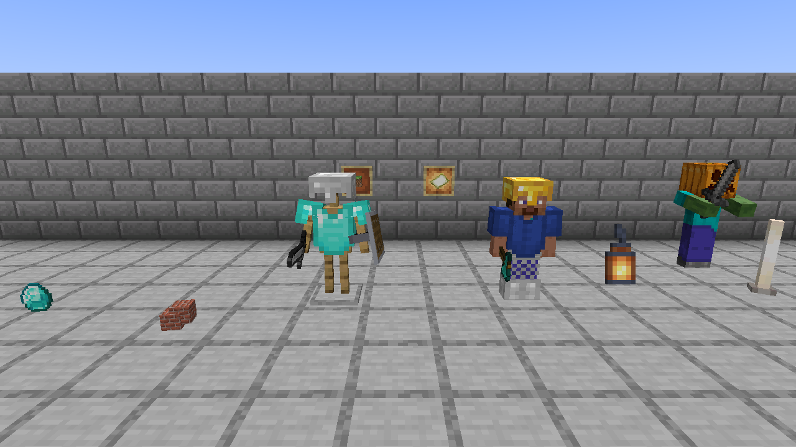

# Lumenwright

An offline, headless renderer for Minecraft Java Edition worlds. You give it a world save and
a camera, and it draws the blocks and entities. It comes as two crates: the `lumenwright`
command (crate `lumenwright-cli`) writes a PNG, and the `lumenwright` library returns the
pixels to your program (see [Library](#library)). It has two looks:

* **quick**: rasterized to look like the vanilla Java client, with no ray tracing.
* **hq**: a path tracer ported from Chunky's, with its Preetham sky, its sun and soft
  shadows, its emitters, its display gamma, and refractive water (what was ported and how
  the result compares with Chunky: [docs/research/chunky-parity.md](docs/research/chunky-parity.md)).

Both modes run on several native backends: **CPU** (all cores), **Metal**, **Vulkan** and
**DX12** (through wgpu), and **CUDA** (the Rust path-tracing kernel compiled to PTX).

## The Treehouse Camp, by day and at dusk


*hq · `--time 4000` · 4096 spp · 8 bounces · CUDA on an NVIDIA GeForce RTX 4070 Ti SUPER · 130 s end to end*

| | quick (vanilla look) | hq (path traced) |
|---|---|---|
| **The whole camp, day** |  quick · `--time 4000` · Metal · Apple M2 Pro |  hq · `--time 4000` · 4096 spp · 8 bounces · CUDA · RTX 4070 Ti SUPER |
| **The whole camp, dusk** |  quick · `--time 12800` · Metal · Apple M2 Pro |  hq · `--time 12800` · 16384 spp · 8 bounces · CUDA · RTX 4070 Ti SUPER |
| **The Long Bridge, day** |  quick · `--time 4000` · Metal · Apple M2 Pro |  hq · `--time 4000` · 4096 spp · 8 bounces · CUDA · RTX 4070 Ti SUPER |
| **The Long Bridge, dusk** |  quick · `--time 12800` · Metal · Apple M2 Pro |  hq · `--time 12800` · 16384 spp · 8 bounces · CUDA · RTX 4070 Ti SUPER |

*The Treehouse Camp* is a small adventure map: a forest clan's houses on four giant trees,
joined by rope bridges and ladders and lit by lanterns. The top rows look at the whole camp
from the east-north-east; the bottom rows stand above the Long Bridge, looking south. All
eight are 1280×720, rendered from a save written by the map's own server.

At `--time 12800` the sun stands on the horizon. Quick mode draws the client's sunset: the sun
disc, the orange glow and the light the game stored in the save. HQ mode draws its own sky,
which has no sunset glow, and lights the camp with its lanterns: each diffuse bounce samples
one emitter, so the valley floor, the bridges and the trunks are lit by the lanterns around
them.

By day the lantern light adds to the sunlight; in the game, block light next to full sky light
adds nothing visible. HQ follows each emitter's light by the inverse square of distance, and
the camp's lanterns make 2169 light-casting quads, so the sunlit floor around each tree glows yellow, and in the Long Bridge
frame, where lanterns stand on every post, the scene is about 70% brighter than the same
frame with `--emitter-intensity 0` (mean 8-bit luma 97 against 56).

Each image's command, run from the repository root with the save from
[Get the camp](#get-the-camp) in `the-treehouse-camp`. The HQ commands need the CUDA build
(see [Backends](#backends)); on another backend the same flags give the same image within the
parity stated under [Measured](#measured-on-an-m2-pro-10-cpu-cores-16-gpu-cores).

```sh
# The whole camp
target/release/lumenwright render -w the-treehouse-camp --camera 140,118,14 --look-at 56,82,58 --fov 60 --render-distance 12 \
    --time 4000 --backend metal -o treehouse-camp-day-quick.png
target/release/lumenwright render -w the-treehouse-camp --camera 140,118,14 --look-at 56,82,58 --fov 60 --render-distance 12 \
    --time 4000 --backend cuda --mode hq --spp 4096 --max-bounces 8 -o treehouse-camp-day-hq.png
target/release/lumenwright render -w the-treehouse-camp --camera 140,118,14 --look-at 56,82,58 --fov 60 --render-distance 12 \
    --time 12800 --backend metal -o treehouse-camp-dusk-quick.png
target/release/lumenwright render -w the-treehouse-camp --camera 140,118,14 --look-at 56,82,58 --fov 60 --render-distance 12 \
    --time 12800 --backend cuda --mode hq --spp 16384 --max-bounces 8 -o treehouse-camp-dusk-hq.png

# The Long Bridge
target/release/lumenwright render -w the-treehouse-camp --camera 60,93,22 --look-at 60,80,42 --fov 70 \
    --time 4000 --backend metal -o treehouse-bridge-day-quick.png
target/release/lumenwright render -w the-treehouse-camp --camera 60,93,22 --look-at 60,80,42 --fov 70 \
    --time 4000 --backend cuda --mode hq --spp 4096 --max-bounces 8 -o treehouse-bridge-day-hq.png
target/release/lumenwright render -w the-treehouse-camp --camera 60,93,22 --look-at 60,80,42 --fov 70 \
    --time 12800 --backend metal -o treehouse-bridge-dusk-quick.png
target/release/lumenwright render -w the-treehouse-camp --camera 60,93,22 --look-at 60,80,42 --fov 70 \
    --time 12800 --backend cuda --mode hq --spp 16384 --max-bounces 8 -o treehouse-bridge-dusk-hq.png
```

| image | Apple M2 Pro, Metal (end to end) | RTX 4070 Ti SUPER, CUDA (end to end / in the kernel) |
|---|---|---|
| camp, quick, day / dusk | 0.27 s / 0.27 s | |
| camp, hq, day (4096 spp) / dusk (16384 spp) | | 130 s / 497 s (125 s / 483 s) |
| bridge, quick, day / dusk | 0.23 s / 0.22 s | |
| bridge, hq, day (4096 spp) / dusk (16384 spp) | | 163 s / 636 s (158 s / 619 s) |

The quick times are the second of two runs; the first run after a build took 1.6 s, reading the
save and the jar from a cold disk cache. The 4070 Ti SUPER runs under WSL2 on a 16-thread PC.
Each HQ image rendered twice with the same command on the CUDA backend gave byte-identical
PNGs, as each quick image did on Metal.

### Image licence

The Treehouse Camp images are renders of *The Treehouse Camp*, from
[stellarfeline/delvewright-campaigns](https://github.com/stellarfeline/delvewright-campaigns),
`campaigns/the-treehouse-camp/`, release `release/the-treehouse-camp/v1.0.1`, licensed
[CC BY-SA 4.0](https://creativecommons.org/licenses/by-sa/4.0/). The renders do not change the
map, and they are shared under the same licence. The other images in `docs/renders/` are
renders of worlds Lumenwright generates (`demo-world`). Every image is drawn with Minecraft's
textures and shared under
[Mojang's usage guidelines](https://www.minecraft.net/en-us/usage-guidelines) for screenshots.

The requirements, design decisions and what is in or out of scope are in
[docs/SCOPE.md](docs/SCOPE.md).

## Install

The command, from crates.io:

```sh
cargo install lumenwright-cli    # installs the `lumenwright` command
lumenwright backends             # the backends this machine can draw with
```

The library, in your own crate:

```sh
cargo add lumenwright
```

You need Rust 1.90 or newer. Installing the command also compiles a little C (the TLS
library its jar downloader uses), so it needs a C compiler; the library alone compiles none.

What each backend needs to run:

* **CPU**: any Linux, macOS or Windows machine. It uses every core.
* **Metal, Vulkan, DX12**: a GPU and its driver: Metal on macOS, Vulkan on Linux or Windows,
  DX12 on Windows. wgpu's environment flags apply; under WSL2 the GPU is reached through
  Mesa's `dzn` Vulkan driver, which wgpu lists only with
  `WGPU_ALLOW_UNDERLYING_NONCOMPLIANT_ADAPTER=1`.
* **CUDA**: an NVIDIA GPU and its driver, and a build from a clone of this repository (see
  [Backends](#backends)).

Every render also needs the Minecraft Java Edition client jar, which Lumenwright reads its
textures and models from. The command finds it or downloads it from Mojang (see
[Textures](#textures-the-chunky-approach)); the library takes its path.

## Quick start

```sh
cargo build --release
```

### Get the camp

The camp ships as a container image that runs the map's own server. The server builds the
camp over its first ticks. These commands wait for it to finish, then save the world and copy
it out. They need Docker. `EULA=TRUE` accepts [Mojang's EULA](https://aka.ms/MinecraftEULA)
for the server inside the container.

```sh
docker run -d --name treehouse-camp -e EULA=TRUE ghcr.io/stellarfeline/delve-the-treehouse-camp:v1.0.1
# The camp is stamped by its datapack over the first ticks; wait until it says so.
until docker exec treehouse-camp rcon-cli scoreboard players get '#placed' dw.sys 2>/dev/null | grep -q 'has 1'; do sleep 5; done
docker exec treehouse-camp rcon-cli save-all flush
docker stop treehouse-camp
docker cp treehouse-camp:/data/world the-treehouse-camp
docker rm treehouse-camp
```

The image is release v1.0.1 of the camp, built by `delvec` 1.12.0 from
`campaigns/the-treehouse-camp/` in
[stellarfeline/delvewright-campaigns](https://github.com/stellarfeline/delvewright-campaigns)
at the release's tag. The campaign's `GENERATION.md` there records how it was built and
checked. The save is written by a running server, so it is not byte-identical from one run
to the next: the same frame of two saves from two server runs differed in 257 of its 921,600 pixels.

### Render

```sh
# Inspect a save
target/release/lumenwright info the-treehouse-camp --entities

# List the block entities (and sign text) in a box of x,z block coordinates
target/release/lumenwright info the-treehouse-camp --block-entities=0,0,112,112

# Vanilla-look render from the save's spawn, at the save's own time of day
target/release/lumenwright render -w the-treehouse-camp -o quick.png

# Chunky-look render from an explicit camera
target/release/lumenwright render -w the-treehouse-camp --mode hq --spp 256 \
    --camera 140,118,14 --look-at 56,82,58 --sun-altitude 35 --sun-azimuth 120 -o hq.png

# Generated worlds, no download: a small showcase (terrain, cottage, lake, mobs)
target/release/lumenwright demo-world showcase
target/release/lumenwright render -w showcase --mode hq -o showcase.png

# One of every block entity Lumenwright draws (the render below)
target/release/lumenwright demo-world --block-entities gallery
target/release/lumenwright render -w gallery \
    --camera 9.5,70.5,11.5 --look-at 9.5,65.4,-2 --fov 60 -o gallery.png
```

`lumenwright backends` lists the backends available on the current machine.

## Textures: the Chunky approach

Mojang's assets are not redistributable, so Lumenwright ships none. Like Chunky, it reads
textures, blockstates and block models straight out of the official client jar. The jar is
resolved in this order:

1. `--minecraft-jar <path>`
2. A launcher's copy for the world's version: the vanilla launcher's
   `versions/<v>/<v>.jar`, Prism Launcher's library, or Lumenwright's own cache
3. Chunky's `~/.chunky/resources/minecraft.jar`, if its version matches
4. A download from Mojang's version manifest (`piston-meta.mojang.com`), SHA-1 verified, into
   the cache (`~/Library/Caches/lumenwright` or `$XDG_CACHE_HOME/lumenwright`). `--offline`
   disables this; `lumenwright assets fetch <version|latest>` downloads ahead of time.

This resolution and the downloader belong to the command. The library takes the jar as a path.

The jar's own `font/include/unifont.json` lists no providers: the client reads the Unifont that
draws CJK and every other character no bitmap font covers from the launcher's asset index. The
command fetches it the same way, in this order: `--unifont <dir>` (a directory holding
`minecraft/font/include/unifont.json` and the hex zip it names, laid out like the index's keys),
then the cache (`<cache>/unifont/<version>`, every file checked against the SHA-1 its lock
records), then a download through the version's asset index, the index and every file checked by
SHA-1 and size. `--offline` forbids the download and refuses, naming what is missing, when
neither of the first two has the files. `lumenwright assets fetch-unifont <version|latest>`
downloads ahead of time. The library takes the directory as `Request::unifont` and does the same
checks on it without any network.

`--resource-pack` (zip or directory, repeatable) layers packs on top of the vanilla assets.

## Command line (render)

| flag | default | meaning |
|---|---|---|
| `-w, --world` | required | save directory (contains `level.dat`) |
| `-o, --output` | render.png | the PNG to write |
| `--mode quick\|hq` | quick | vanilla raster or path tracing |
| `--backend auto\|cpu\|gpu\|metal\|vulkan\|dx12\|cuda` | auto | `auto` uses the GPU if one is available, otherwise the CPU |
| `--camera x,y,z` | player eye, else spawn | eye position |
| `--yaw`, `--pitch` | player's | Minecraft convention: yaw 0 = south, 90 = west; pitch > 0 looks down |
| `--look-at x,y,z` | | overrides yaw and pitch |
| `--fov` | 70 | vertical field of view in degrees |
| `--width`, `--height` | 1280×720 | output size |
| `--render-distance` | 8 | chunk radius loaded around the camera |
| `--dimension` | overworld | `overworld`, `nether`, `end` |
| `--time` | world time | ticks: 0 = sunrise, 6000 = noon |
| `--sun-altitude`, `--sun-azimuth` | from time, 135 | degrees (azimuth 0 = north, 90 = east); an altitude overrides `--time` for the sun |
| `--spp`, `--max-bounces`, `--seed` | 64, 4, 0 | HQ sampling; the same seed gives the same image |
| `--exposure`, `--tonemap gamma\|aces\|filmic` | 1.0, gamma | HQ post-processing, Chunky's filters (each ends in the display gamma 2.2) |
| `--sun-intensity`, `--sky-intensity` | 1.25, 1 | HQ lighting: Chunky's sun intensity (irradiance intensity^2.2) and sky light |
| `--emitter-intensity` | 13 | HQ: Chunky's emitter intensity; an emitting surface emits its texel colour squared times its block's emittance times this (0 turns emitters off) |
| `--emitter-sampling none\|one\|one-block\|all`, `--prevent-normal-emitter` | one | HQ: Chunky's emitter sampling strategies, and its "prevent normal emitter with sampling" |
| `--ssaa N` | 1 | quick-mode supersampling |
| `--mipmap-levels N` | 4 | quick-mode mip levels for block textures, 0 (off) to 4, as the client's option |
| `--brightness`, `--flat-lighting` | 0.5 | vanilla brightness slider, and smooth lighting off |
| `--hdr-output out.pfm` | | also write the linear HDR image (HQ) |
| `--no-entities`, `--players`, `--unknown-entities box\|skip` | | entity options |
| `--no-block-entities` | | leave out block entities drawn by Java code |
| `--minecraft-jar`, `--mc-version`, `--unifont`, `--offline`, `--resource-pack` | | the client jar, the Unifont and packs (see [Textures](#textures-the-chunky-approach)) |
| `--threads`, `--log` | all cores, info | CPU worker threads and log level, for every subcommand |

## Library

`lumenwright::render(&Request)` draws one frame and returns a `Rendered`. The request names
every input: the world (a save directory, or a `World` you opened) and the inclusive chunk
rectangle to load, the client jar and resource packs as paths, the camera, the mode, the
backend, the size, the quick and HQ options, which entities to draw, and the sky. The sky is
either vanilla's at a time of day (`Sky::Vanilla`) or the colours and sun you state
(`Sky::Stated`).

```rust
use std::path::Path;
use lumenwright::glam::DVec3;
use lumenwright::render::{BackendKind, Mode};
use lumenwright::scene::camera::Camera;
use lumenwright::world::Dimension;
use lumenwright::*;

let camera = Camera { pos: DVec3::new(18.5, 73.6, 22.5), yaw: 150.0, pitch: 18.0, fov_y: 70.0 };
let frame = lumenwright::render(&Request {
    world: WorldSource::Dir { path: Path::new("saves/MyWorld"), dimension: Dimension::Overworld },
    chunks: ChunkRect::around(camera.pos, 8),
    jar: Path::new("minecraft-1.21.11-client.jar"),
    resource_packs: &[],
    camera,
    mode: Mode::Quick,
    backend: BackendKind::Auto,
    width: 1280,
    height: 720,
    entities: EntityPolicy::default(),
    quick: QuickOptions::default(),
    hq: HqOptions::default(),
    sky: Sky::default(),
})?;
// frame.rgba: RGBA8, top row first. frame.backend, frame.backend_fallback,
// frame.timings, frame.entity_stats, frame.block_entity_stats: what was drawn and how.
```

`render` does not look for a jar, use the network, write files or print. When it refuses a
request before drawing (a missing jar, an empty image, no chunks in the rectangle), the
error holds a `RequestError` you can match with `err.downcast_ref::<RequestError>()`. On the
CPU backend the same request gives the same bytes whatever the thread count.

The library crate holds no command-line code, no jar resolver and no downloader. Its default
feature, `gpu`, adds the Metal, Vulkan and DX12 backends; `cuda` adds the CUDA backend. With
the default features it compiles no C code, so it cross-checks for Linux, macOS and Windows
targets without a cross C compiler. The `lumenwright render` command calls the same
function, so the command and the library draw the same pixels.

## Architecture

```
crates/lumenwright/        the library
  world/      Anvil regions, paletted chunk sections, light, biomes, entities, level.dat
  assets/     blockstate variants/multipart, model baking, atlas, biome tints, font, lang
  scene/      material-resolved quads; quick mesh (culling, smooth light + AO);
              HQ brick grid (16³ bricks, u16 model instances, entity overlay cells); entity models
  request.rs  the entry point: Request -> render() -> Rendered
  render/     Backend trait
    cpu/        tile-binned software rasterizer + lumenwright-kernel on rayon
    gpu/        wgpu: quick.wgsl (raster pipeline), pathtrace.wgsl (compute port of the kernel)
    cuda.rs     lumenwright-kernel compiled to PTX, launched via cudarc
crates/lumenwright-cli/    the `lumenwright` command, over the library's public API
  main.rs     subcommands, logging
  job.rs      render: flags -> Request -> render() -> PNG/PFM
  jar.rs      client-jar resolution and download
  output.rs   PNG and PFM writers
  values.rs   flag values for the library's option enums
  fixture.rs  generated worlds for demo-world and the tests
crates/lumenwright-kernel/ #![no_std] path tracer shared by CPU and CUDA (same source)
crates/lumenwright-ptx/    CUDA entry point (builds for nvptx64-nvidia-cuda)
```

Both modes share one scene build. Quick mode turns visible quads into a triangle mesh, the
way the vanilla client does. HQ mode instances block models inside a sparse two-level voxel
grid: empty bricks are skipped and fully buried bricks are collapsed, so a ray needs one
traversal loop and no BVH. Entities go into sparse overlay cells of the same grid.

Backend parity is by construction. The CPU and CUDA backends run the same Rust kernel. The
WGSL kernel mirrors it line by line and uses the same RNG, so CPU and Metal draw the same
random numbers for each pixel and sample. Builds are deterministic: identical inputs give
bit-identical images.

Quick mode samples block textures as the 1.21.11 client does: each sprite of the client's
block atlas (`atlases/blocks.json`) gets a mip chain built like `MipmapGenerator` builds it
(a linear-light 2×2 mean; cutout textures keep their alpha-test coverage; the `.mcmeta`
`mipmap_strategy` and `alpha_cutoff_bias` apply), padded and aligned like the client's
stitcher so no level bleeds into a neighbour, and read through `terrain.fsh`'s
`sampleNearest` with trilinear, 4× anisotropic filtering. Pixel art stays sharp up close and
distant terrain does not shimmer. Entities, items and text are read nearest, as the client
reads its other atlases. The quick sky is the client's `SkyRenderer`: the fogged sky disc, the
sunrise and sunset glow, the sun, this night's moon phase and the 1500 stars, with every
colour and angle read from the jar's environment attributes and day timeline (dimension,
biome at the camera, time of day). The world fog adds the client's environmental fog to the
render-distance fog. HQ mode keeps its own sky model; both modes place the sun at the
timeline's `sun_angle`.

Mob geometry lives in Java code in vanilla, not in assets, so it ships as data in
[`crates/lumenwright/assets/entity_models.json`](crates/lumenwright/assets/entity_models.json):
57 mobs in vanilla's own part, cube and box-UV terms, transcribed from 1.21.11. Adding a mob
needs no Rust changes. Block displays, paintings and mannequin or player skins are built in
code. Anything else is drawn as a box the size of its hitbox.

Text displays are drawn in the jar's default font (`assets/minecraft/font/default.json` and
the bitmap providers it names), placed as the client places them: the `text` component with
its colours, bold, italic and `translate` keys, split into lines no wider than `line_width`,
`alignment`, the `background` colour or `default_background`, `shadow`, `billboard` and
`transformation`. A `see_through` display is drawn over whatever stands in front of it. A text
display is seen from the front only, as in the game. `text_opacity` and `brightness` are not
read. A character no bitmap provider covers is drawn from the Unifont (see
[Textures](#textures-the-chunky-approach)), cut and spaced as the client's unihex provider cuts
and spaces it; without a Unifont directory it is left out.


Block entities that vanilla draws in Java code use the same format, in
[`crates/lumenwright/assets/block_entity_models.json`](crates/lumenwright/assets/block_entity_models.json),
each model naming the 1.21.11 client class it is transcribed from. Their data comes from the
chunk's `block_entities`:

* signs and hanging signs, with front and back text in the vanilla bitmap font
  (`assets/minecraft/font`), dye colour, glowing text and its outline. A `translate` line
  resolves through the `en_us` language files of the jar and the resource packs;
* bells, the lectern's book and the enchanting table's book;
* chests: single, double, trapped, ender and copper;
* banners, with their pattern layers composited in their dye colours;
* decorated pots with their sherds;
* skulls and heads. A player head's skin is the profile's `texture` asset when a resource
  pack provides it, otherwise the default skin for the profile's UUID. Skins are never
  downloaded.


Items are drawn through the jar's item model definitions (`assets/minecraft/items/*.json`,
the format of 1.21.4 and later), resolved against the stack's components and where it is
drawn. A model with elements is baked as a block model; a flat item is extruded from its
sprite, a front and a back face and one face for every open texel edge, as the client does.
The model's display transform for its context poses it:

* dropped items (`ground`), bobbing and turned by a phase taken from the entity's UUID, as
  a cluster of up to five copies for a large stack;
* item frame and glow item frame contents (`fixed`), turned by `ItemRotation`;
* item displays, in their `item_display` context, `transformation` and `billboard`;
* items in the hands (`thirdperson_righthand`, `thirdperson_lefthand`) and non-armour items
  on the head (`head`) of armour stands, mannequins, players and humanoid mobs. Armour
  stands take their `Pose` and `ShowArms`.

Worn armour is drawn from the jar's equipment assets (`assets/minecraft/equipment/*.json`)
on the humanoid armour meshes, dyed leather included. The shield is drawn from data in
[`crates/lumenwright/assets/item_models.json`](crates/lumenwright/assets/item_models.json),
with the armour meshes, each citing its 1.21.11 client class. `EntityStats` counts the
stacks drawn and not drawn by item id (`items_rendered`, `items_skipped`).



```sh
target/release/lumenwright demo-world --items /tmp/items
target/release/lumenwright render -w /tmp/items \
    --camera 7.5,67.6,9.5 --look-at 7.5,66.0,2.5 --fov 60
```

## Backends

| backend | quick | hq | tested here (Apple M2 Pro) |
|---|---|---|---|
| cpu | software rasterizer | Rust kernel on rayon | yes |
| metal | wgpu render pipeline | WGSL compute | yes, matches the CPU (see below) |
| vulkan / dx12 | same wgpu code | same WGSL | no, but these are the same code paths as Metal |
| cuda | falls back to the CPU rasterizer | Rust kernel as PTX | not on the M2 Pro; on an RTX 4070 Ti SUPER (WSL2) HQ matches the CPU |

The CUDA backend needs the PTX built first:

```sh
scripts/build-ptx.sh                       # rustup target nvptx64-nvidia-cuda + llvm-bitcode-linker
cargo build --release -p lumenwright-cli --features cuda
lumenwright render ... --mode hq --backend cuda
```

`libcuda` is loaded at runtime, so CUDA builds work on machines without the CUDA toolkit.

`scripts/build-ptx.sh` refuses a kernel whose PTX carries an f64 instruction (consumer NVIDIA
GPUs run f64 at a small fraction of f32 speed) or calls a function other than a panic. The
path tracer is inlined whole into the kernel because, with its functions called, the driver's
optimizing PTX compiler (driver 616.92) produced wrong pixels or launches that never finished,
while the same PTX compiled without optimization matched the CPU.

On WSL2 the driver library is `/usr/lib/wsl/lib/libcuda.so.1`. A Linux NVIDIA driver package
installed inside WSL (Ubuntu's `libnvidia-compute-*`, pulled in by `nvidia-utils-*`) puts a
native `libcuda.so` in `/usr/lib/x86_64-linux-gnu`, which the backend loads first and which
finds no device (`cuInit` returns 100, `CUDA_ERROR_NO_DEVICE`). Run with
`LD_LIBRARY_PATH=/usr/lib/wsl/lib`, or remove that package.

An HQ frame logs its kernel time by CUDA events beside the wall clock (`--log info`).

## Testing

```sh
cargo test --workspace --release
```

* **Unit tests** cover region and NBT decoding, the LZ4 framing, palette unpacking, multipart
  rules, model baking orientation and UVs, the camera convention, sky and day cycle, the
  environment attribute layering, mip chains (the client's lookup tables and cutout
  coverage), quick-mode texture sampling, the lightmap, the tonemapper, and entity box-UV
  and orientation.
* **Kernel tests** use hand-built buffers to check brick skipping, uniform bricks, entity
  overlay cells, cutout alpha, one-sided faces met far along a ray, coplanar faces, the
  sky, Chunky's emitter sampling against its expectation, and pinned RNG values; the kernel's
  `f32` `ln`, `acos` and gamma decoding are held to bounds against `f64`. A unit test holds
  the kernel's sky to Chunky's Preetham sky transcribed in `f64`.
* **Integration tests** (in `lumenwright-cli`, which owns the fixture worlds) write fixture
  worlds and render them end to end. They check terrain
  colours seen from above, entity coverage, block entities in both modes, sign text, items
  in both modes (every holder kind, each item's spot against the same frame with the
  holders empty), that every item definition in the jar resolves, HQ sanity, CPU-vs-GPU
  parity in both modes (showcase, block-entity gallery and item gallery) and CPU-vs-CUDA
  parity in HQ mode, determinism, and the CLI. The library tests check that the CLI's PNG
  and the library's pixels are byte-equal in both modes, that a missing jar is refused by
  name, that a stated sky is drawn as given, that the vanilla sky's colour at noon, dusk and
  midnight matches the jar's day timeline within 2/255, and that CPU pixels are
  bit-identical on 1, 3 and 8 threads (showcase and item gallery). A far-plane test measures
  the high-frequency energy and the change under a sub-pixel camera move with and without
  mipmaps. Tests that need the
  client jar or a GPU skip with a message when it is missing. `LUMENWRIGHT_MC_JAR` points the tests at a jar.

## Measured on an M2 Pro (10 CPU cores, 16 GPU cores)

| scene | mode / backend | time |
|---|---|---|
| The Treehouse Camp, whole-camp view at `--time 4000`, 625 chunks loaded, 1920×1080 | quick / metal | 0.28 s end to end (48 ms raster, 982k triangles) |
| same | quick / cpu | 0.36 s end to end (139 ms raster) |
| same, 1280×720, 32 spp, 4 bounces | hq / metal | 4.1 s end to end (3.9 s path tracing) |
| same, 1280×720, 16 spp, 4 bounces | hq / cpu | 6.1 s end to end (5.9 s path tracing) |
| showcase (`demo-world`, its default camera), 1280×720, 256 spp | hq / metal | 14.7 s |

Parity on the whole-camp view at `--time 4000`, CPU vs Metal: in quick mode at 1920×1080, 0.22%
of pixels differ by more than 8/255; in HQ mode at 1280×720 and 32 spp, 0.001% do (12 pixels).

## HQ mode and Chunky on one frame

The whole-camp view of The Treehouse Camp at 1280×720, 250 samples per pixel, four bounces, with Chunky's default sky,
sun, emitters and tone map (the full method: [docs/research/chunky-parity.md](docs/research/chunky-parity.md)).
Against Chunky's frame converged at 4000 samples, Lumenwright's 250-sample frame differs by a
mean of 1.70/255 (SSIM 0.959), Chunky's own 250-sample frame by 1.99/255 (SSIM 0.958).

| renderer | machine | path tracing, median of 3 | whole command, median of 3 | vs Chunky |
|---|---|---|---|---|
| Chunky 2.5.0-SNAPSHOT.474 (CPU) | M2 Pro | 124.73 s | 129.61 s | 1× |
| Lumenwright, Metal | M2 Pro | 32.96 s | 33.26 s | 3.8× / 3.9× |
| Lumenwright, CUDA | RTX 4070 Ti SUPER | 6.15 s | 6.72 s | different machine |

```sh
# Lumenwright (--backend metal on the M2 Pro, cuda on the 4070)
target/release/lumenwright render -w the-treehouse-camp --camera 140,118,14 --look-at 56,82,58 --fov 60 --render-distance 12 \
    --time 4000 --sun-altitude 45 --sun-azimuth 135 --mode hq --spp 250 --max-bounces 4 --backend metal -o lw.png
# Chunky: the pinned core on its own classpath, as Delvewright's validation/chunky.sh runs it, without its denoise step
mkdir -p scenes && cp docs/bench/treehouse-camp-bench.json scenes/
java -Djava.awt.headless=true -Dchunky.home=$HOME/.chunky -cp "<the pinned core and its libraries>" se.llbit.chunky.main.Chunky \
    -scene-dir scenes -render treehouse-camp-bench -f
```

The Chunky scene ([`docs/bench/treehouse-camp-bench.json`](docs/bench/treehouse-camp-bench.json); its world path is read from the working directory) states the same 625 chunks, the camera
at 140, 118, 14 with Chunky's yaw 0.483 rad and pitch −1.208 rad (looking at 56, 82, 58), a 60°
vertical field of view, `sppTarget` 250, `rayDepth` 5 (four bounces after the first hit,
read off the pinned core's `PathTracer`), `emittersEnabled`, `emitterSamplingStrategy` `ONE`,
and the sun at altitude π/4 and Chunky azimuth π/4 (towards +X +Z).

## Measured on an RTX 4070 Ti SUPER (driver 616.92, WSL2)

| scene | mode / backend | time |
|---|---|---|
| showcase, 1280×720, 64 spp, 4 bounces | hq / cuda | 0.85 s in the kernel (CUDA events), 1.43 s end to end |

The same frame on CUDA and on the CPU: no pixel differs by more than 0.05 in linear radiance.

## Known limitations (v0.1)

See [docs/SCOPE.md §3](docs/SCOPE.md). The main gaps:
* Beds, shulker boxes and the conduit are not drawn. Chests are drawn closed and bells at
  rest; sign text is drawn without italic, underline or obfuscation.
* Items that vanilla draws in Java code are not drawn, the shield excepted: chests, beds,
  banners, heads, shulker boxes, decorated pots, the conduit and copper golem statues. They
  are counted in `items_skipped`. A filled map in a frame shows the map item, not its
  picture; armour trims and the elytra are not drawn.
* Entity layers that need a second texture are missing (sheep wool, glowing eyes).
* Smooth fluid surfaces, clouds, weather and biome blending are not implemented. In quick
  mode the End's sky box is drawn as its fog colour, the dark disc vanilla draws below the
  horizon for a camera under sea level is not drawn, and the lightmap's daylight still
  follows the pre-1.21.11 day curve.
* HQ mode lights emitters as Chunky does, and Chunky's emitter sampling is not a light
  transport estimate: it picks one emitter near the surface without dividing by the pick's
  probability, so a surface among many emitters gets the average of their light rather
  than the sum, and an emitter farther than 10 to 19 blocks along an axis (by where the grid
  cells fall) is never sampled; it lights a surface only through bounced paths that meet it.
* Not yet ported from Chunky: biome blending, the sun drawn in the sky, candle and campfire
  flame particles, its fancier translucency, water shading and metals
  ([docs/research/chunky-parity.md](docs/research/chunky-parity.md)).

## License

Lumenwright is free software: you can redistribute it and/or modify it under the terms of the
GNU General Public License as published by the Free Software Foundation, either version 3 of
the License, or (at your option) any later version. See [LICENSE](LICENSE).

NOT AN OFFICIAL MINECRAFT PRODUCT. NOT APPROVED BY OR ASSOCIATED WITH MOJANG OR MICROSOFT.
Minecraft is a trademark of Mojang AB. Lumenwright ships no Minecraft assets: textures and models
are read at run time from the user's own copy of the game.
