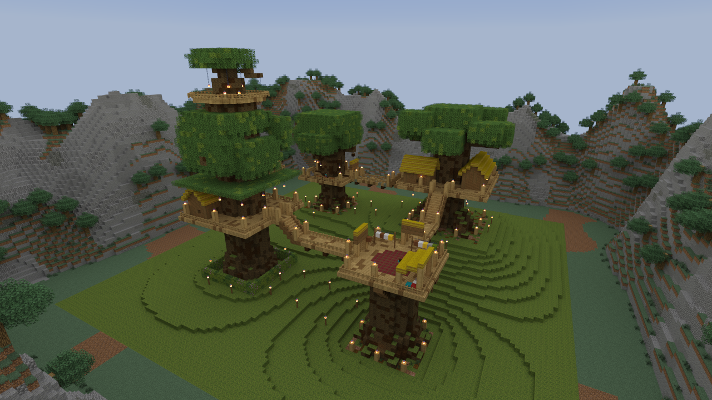
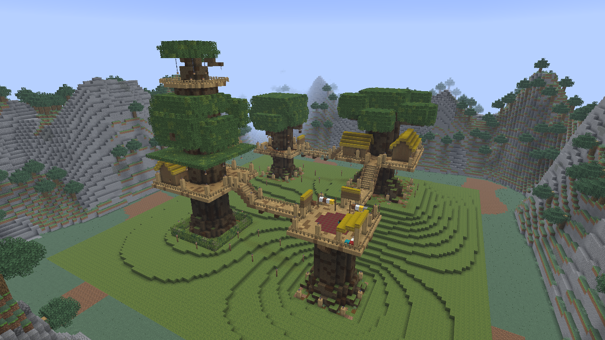
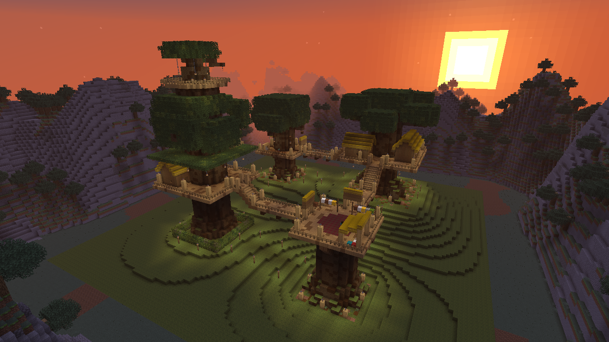
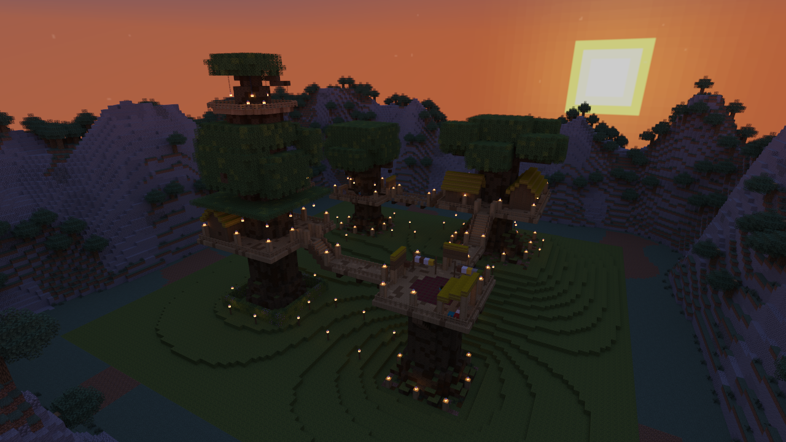
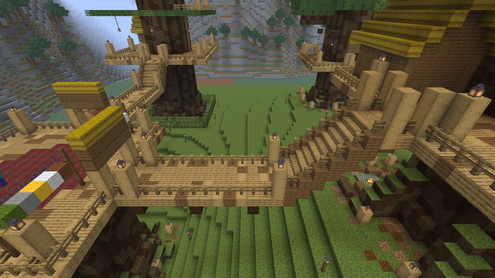
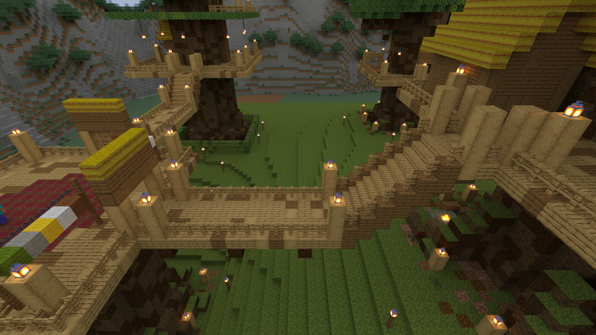
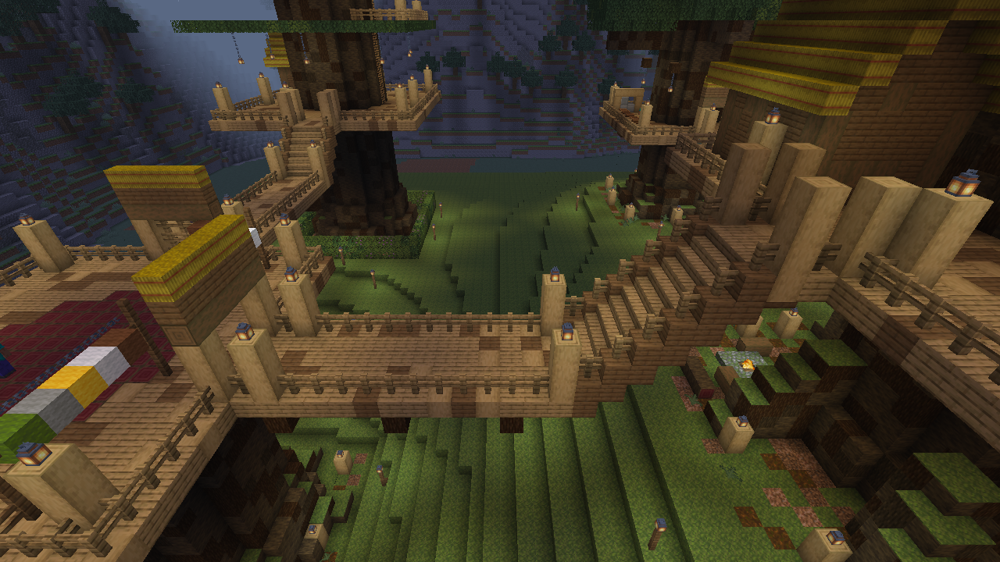
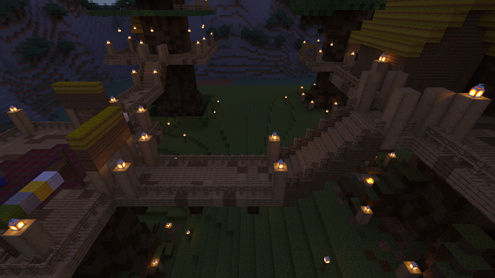

# Lumenwright

An offline, headless renderer for Minecraft Java Edition worlds. You give it a world save and
a camera, and it draws the blocks and entities. It comes as two crates: the `lumenwright`
command (crate `lumenwright-cli`) writes a PNG, and the `lumenwright` library returns the
pixels to your program (see [Library](docs/library.md#library)). It has two looks:

* **quick**: rasterized to look like the vanilla Java client, with no ray tracing.
* **hq**: a path tracer ported from Chunky's, with its emitters, its display gamma and
  refractive water. By default it lights the frame as the game lights the hour: the
  client's own sky in view, the light of the client's lightmap, no sunlight
  ([docs/research/game-sky.md](docs/research/game-sky.md)). Chunky's Preetham sky, with its
  sun and soft shadows, is `--sky chunky` (what was ported and how the result compares with
  Chunky: [docs/research/chunky-parity.md](docs/research/chunky-parity.md)).

Both modes run on several native backends: **CPU** (all cores), **Metal**, **Vulkan** and
**DX12** (through wgpu), and **CUDA** (the Rust path-tracing kernel compiled to PTX).

## The Treehouse Camp, by day and at dusk



*hq · `--time 4000` · 4096 spp · 8 bounces · CUDA on an NVIDIA GeForce RTX 4070 Ti SUPER · 66 s end to end*

| | quick (vanilla look) | hq (path traced) |
|---|---|---|
| **The whole camp, day** |  quick · `--time 4000` · Metal · Apple M2 Pro |  hq · `--time 4000` · 4096 spp · 8 bounces · CUDA · RTX 4070 Ti SUPER |
| **The whole camp, dusk** |  quick · `--time 12800` · Metal · Apple M2 Pro |  hq · `--time 12800` · 16384 spp · 8 bounces · CUDA · RTX 4070 Ti SUPER |
| **The Long Bridge, day** |  quick · `--time 4000` · Metal · Apple M2 Pro |  hq · `--time 4000` · 4096 spp · 8 bounces · CUDA · RTX 4070 Ti SUPER |
| **The Long Bridge, dusk** |  quick · `--time 12800` · Metal · Apple M2 Pro |  hq · `--time 12800` · 16384 spp · 8 bounces · CUDA · RTX 4070 Ti SUPER |

*The Treehouse Camp* is a small adventure map: a forest clan's houses on four giant trees,
joined by rope bridges and ladders and lit by lanterns. The top rows look at the whole camp
from the east-north-east; the bottom rows stand above the Long Bridge, looking south. All
eight are 1280×720, rendered from a save written by the map's own server.

Each image's command, its time and how HQ mode lights it: [docs/renders.md](docs/renders.md).

### Image licence

The Treehouse Camp images are renders of *The Treehouse Camp*, from
[stellarfeline/delvewright-campaigns](https://github.com/stellarfeline/delvewright-campaigns),
`campaigns/the-treehouse-camp/`, release `release/the-treehouse-camp/v1.0.1`, licensed
[CC BY-SA 4.0](https://creativecommons.org/licenses/by-sa/4.0/). The renders do not change the
map, and they are shared under the same licence. The other images in `docs/renders/` are
renders of worlds Lumenwright generates (`demo-world`). Every image is drawn with Minecraft's
textures and shared under
[Mojang's usage guidelines](https://www.minecraft.net/en-us/usage-guidelines) for screenshots.

The requirements, design decisions and what is in or out of scope are in
[docs/SCOPE.md](docs/SCOPE.md).

## Install

The command, from this repository (it is not on crates.io):

```sh
cargo install --locked --git https://github.com/stellarfeline/lumenwright --tag v0.1.0 lumenwright-cli
lumenwright backends             # the backends this machine can draw with
```

Rust versions, each checked with `cargo +<version> check`: the command (`lumenwright-cli`, at
`v0.1.0` and on `main`) and the library (`lumenwright`) build on Rust 1.90 and not on 1.89;
the kernel (`lumenwright-kernel`) builds on 1.88 and not on 1.87. Installing the command also
compiles a little C (`ring`, for the TLS its jar downloader uses), so it needs a C compiler; the
library, with or without its default features, compiles none.

What each backend needs to run:

* **CPU**: any Linux, macOS or Windows machine. It uses every core.
* **Metal, Vulkan, DX12**: a GPU and its driver: Metal on macOS, Vulkan on Linux or Windows,
  DX12 on Windows. wgpu's environment flags apply. Under WSL2 on the PC the benchmark runs on,
  wgpu finds only a software Vulkan adapter, with or without
  `WGPU_ALLOW_UNDERLYING_NONCOMPLIANT_ADAPTER=1`; use CUDA there.
* **CUDA**: an NVIDIA GPU and its driver, and the kernel's PTX built from a clone of this
  repository (see [Backends](docs/backends.md#backends)).

Every render also needs the Minecraft Java Edition client jar, which Lumenwright reads its
textures and models from. The command finds it or downloads it from Mojang (see
[Textures](docs/textures.md#textures-the-chunky-approach)); the library takes its path.

## Quick start

Render a save from an explicit camera, path traced under the game's sky at dusk:

```sh
lumenwright render -w path/to/save --camera 140,118,14 --look-at 56,82,58 --time 12800 --mode hq --spp 256 -o hq.png
```

From Rust, with `lumenwright = "0.1.0"` in `[dependencies]`:

```rust
use std::path::Path;
use lumenwright::glam::DVec3;
use lumenwright::render::{BackendKind, Mode};
use lumenwright::scene::camera::Camera;
use lumenwright::world::Dimension;
use lumenwright::*;

let camera = Camera { pos: DVec3::new(18.5, 73.6, 22.5), yaw: 150.0, pitch: 18.0, fov_y: 70.0 };
let frame = lumenwright::render(&Request {
    world: WorldSource::Dir { path: Path::new("saves/MyWorld"), dimension: Dimension::Overworld },
    chunks: ChunkRect::around(camera.pos, 8),
    jar: Path::new("minecraft-1.21.11-client.jar"),
    unifont: None,
    resource_packs: &[],
    camera,
    mode: Mode::Quick,
    backend: BackendKind::Auto,
    width: 1280,
    height: 720,
    entities: EntityPolicy::default(),
    quick: QuickOptions::default(),
    hq: HqOptions::default(),
    sky: Sky::default(),
})?;
// frame.rgba: RGBA8, top row first.
```

The Treehouse Camp save, more commands and generated worlds: [docs/renders.md](docs/renders.md).

## Documentation

* [The Treehouse Camp renders](docs/renders.md): each image's command and time, how HQ mode lights it, getting the camp, more commands.
* [Benchmark](docs/benchmark.md): Lumenwright against Chunky on one machine, the backends against each other, the cost of samples; design, tables and instruments.
* [The game's sky](docs/research/game-sky.md) and [HQ mode against Chunky](docs/research/chunky-parity.md): what HQ mode ports and how it compares.
* [Command line](docs/cli.md): every `render` flag.
* [Library](docs/library.md): using the crate and the `render` API.
* [Textures](docs/textures.md): the client jar, the Unifont and resource packs.
* [Architecture](docs/architecture.md): the crates, the scene, and what each mode draws.
* [Backends](docs/backends.md): CPU, Metal, Vulkan, DX12 and CUDA, and building the PTX.
* [Testing](docs/testing.md), [Known limitations](docs/limitations.md), [Releasing](docs/releasing.md), [Scope](docs/SCOPE.md).

## License

Lumenwright is free software: you can redistribute it and/or modify it under the terms of the
GNU General Public License as published by the Free Software Foundation, either version 3 of
the License, or (at your option) any later version. See [LICENSE](LICENSE).

NOT AN OFFICIAL MINECRAFT PRODUCT. NOT APPROVED BY OR ASSOCIATED WITH MOJANG OR MICROSOFT.
Minecraft is a trademark of Mojang AB. Lumenwright ships no Minecraft assets: textures and models
are read at run time from the user's own copy of the game.
