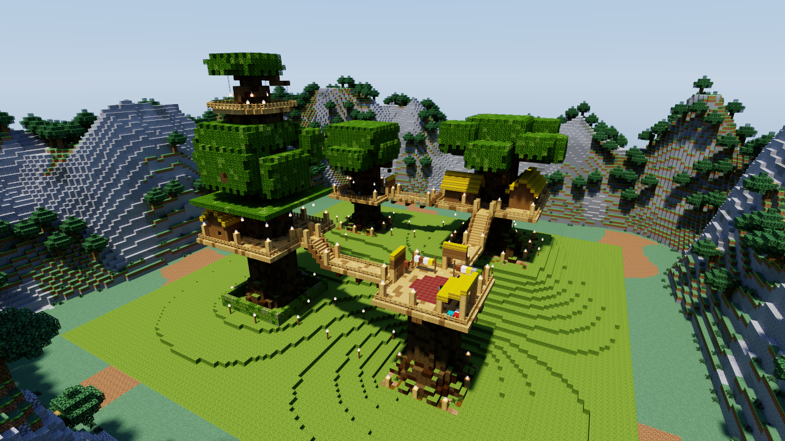

# Lumenwright

An offline, headless renderer for Minecraft Java Edition worlds. You give it a world save and
a camera, and it draws the blocks and entities. It comes as two crates: the `lumenwright`
command (crate `lumenwright-cli`) writes a PNG, and the `lumenwright` library returns the
pixels to your program (see [Library](#library)). It has two looks:

* **quick**: rasterized to look like the vanilla Java client, with no ray tracing.
* **hq**: a Chunky-style path tracer with sun and sky light, soft shadows, emissive blocks
  and refractive water.

Both modes run on several native backends: **CPU** (all cores), **Metal**, **Vulkan** and
**DX12** (through wgpu), and **CUDA** (the Rust path-tracing kernel compiled to PTX).

## The Treehouse Camp, by day and at dusk



*hq · `--time 4000` · 4096 spp · CUDA on an NVIDIA GeForce RTX 4070 Ti SUPER · 74 s end to end*

| | quick (vanilla look) | hq (path traced) |
|---|---|---|
| **The whole camp, day** |  quick · `--time 4000` · Metal |  hq · `--time 4000` · 256 spp · Metal |
| **The whole camp, dusk** |  quick · `--time 12800` · Metal |  hq · `--time 12800` · 1024 spp · Metal |
| **The Long Bridge, day** |  quick · `--time 4000` · Metal |  hq · `--time 4000` · 256 spp · Metal |
| **The Long Bridge, dusk** |  quick · `--time 12800` · Metal |  hq · `--time 12800` · 1024 spp · Metal |

*The Treehouse Camp* is a small adventure map: a forest clan's houses on four giant trees,
joined by rope bridges and ladders and lit by lanterns. The top rows look at the whole camp
from the east-north-east; the bottom rows stand above the Long Bridge, looking south. All
eight are 1280×720, rendered from a save written by the map's own server, on an Apple M2 Pro.

At dusk, quick mode draws the light the game stored in the save, so the lantern-lit valley
reads warmer than the hills around it. HQ mode finds a lantern's light only when a bounced
path happens to hit the lantern, because it does not sample emitters yet. At 1024 spp the
lanterns glow and light the posts they stand on, and the evening sky lights the rest. After
about `--time 13000` the sun is down, and an HQ frame at these sample counts shows lanterns
on black.

The lantern light at dusk is not short of samples. On the RTX 4070 Ti SUPER the dusk frames at
16384 spp ([camp](docs/renders/treehouse-camp-dusk-hq-4070.png),
[bridge](docs/renders/treehouse-bridge-dusk-hq-4070.png)) have the same mean brightness as
the 1024 spp frames above, with less grain: the lanterns light their own posts and little
else. Sampling emitters would bring that picture at fewer samples; it would not make the
lanterns light the valley.

Each image's command, run from the repository root with the save from
[Get the camp](#get-the-camp) in `the-treehouse-camp`:

```sh
# The whole camp
target/release/lumenwright render -w the-treehouse-camp --camera 140,118,14 --look-at 56,82,58 --fov 60 --render-distance 12 \
    --time 4000 --backend metal -o treehouse-camp-day-quick.png
target/release/lumenwright render -w the-treehouse-camp --camera 140,118,14 --look-at 56,82,58 --fov 60 --render-distance 12 \
    --time 4000 --backend metal --mode hq --spp 256 -o treehouse-camp-day-hq.png
target/release/lumenwright render -w the-treehouse-camp --camera 140,118,14 --look-at 56,82,58 --fov 60 --render-distance 12 \
    --time 12800 --backend metal -o treehouse-camp-dusk-quick.png
target/release/lumenwright render -w the-treehouse-camp --camera 140,118,14 --look-at 56,82,58 --fov 60 --render-distance 12 \
    --time 12800 --backend metal --mode hq --spp 1024 -o treehouse-camp-dusk-hq.png

# The Long Bridge
target/release/lumenwright render -w the-treehouse-camp --camera 60,93,22 --look-at 60,80,42 --fov 70 \
    --time 4000 --backend metal -o treehouse-bridge-day-quick.png
target/release/lumenwright render -w the-treehouse-camp --camera 60,93,22 --look-at 60,80,42 --fov 70 \
    --time 4000 --backend metal --mode hq --spp 256 -o treehouse-bridge-day-hq.png
target/release/lumenwright render -w the-treehouse-camp --camera 60,93,22 --look-at 60,80,42 --fov 70 \
    --time 12800 --backend metal -o treehouse-bridge-dusk-quick.png
target/release/lumenwright render -w the-treehouse-camp --camera 60,93,22 --look-at 60,80,42 --fov 70 \
    --time 12800 --backend metal --mode hq --spp 1024 -o treehouse-bridge-dusk-hq.png

# On the RTX 4070 Ti SUPER (build the PTX first, see Backends)
target/release/lumenwright render -w the-treehouse-camp --camera 140,118,14 --look-at 56,82,58 --fov 60 --render-distance 12 \
    --time 4000 --backend cuda --mode hq --spp 4096 -o treehouse-camp-day-hq-4070.png
target/release/lumenwright render -w the-treehouse-camp --camera 140,118,14 --look-at 56,82,58 --fov 60 --render-distance 12 \
    --time 12800 --backend cuda --mode hq --spp 16384 -o treehouse-camp-dusk-hq-4070.png
target/release/lumenwright render -w the-treehouse-camp --camera 60,93,22 --look-at 60,80,42 --fov 70 \
    --time 12800 --backend cuda --mode hq --spp 16384 -o treehouse-bridge-dusk-hq-4070.png
```

| image | M2 Pro, Metal (end to end) | RTX 4070 Ti SUPER, CUDA (end to end) |
|---|---|---|
| camp, quick, day / dusk | 0.4 s / 1.0 s | |
| camp, hq, day (256 spp) / dusk (1024 spp) | 21 s / 70 s | 5.1 s / 16.5 s |
| bridge, quick, day / dusk | 0.3 s / 0.3 s | |
| bridge, hq, day (256 spp) / dusk (1024 spp) | 25 s / 87 s | 6.3 s / 21.6 s |
| camp, hq, day (4096 spp) / dusk (16384 spp) | | 74 s / 260 s |
| bridge, hq, dusk (16384 spp) | | 340 s |

The 4070 Ti SUPER runs under WSL2 on a 16-thread PC. Its 256 and 1024 spp frames differ from
the M2 Pro's Metal frames in at most 38 of 921,600 pixels by more than 8/255.

### Image licence

The Treehouse Camp images are renders of *The Treehouse Camp*, from
[stellarfeline/delvewright-campaigns](https://github.com/stellarfeline/delvewright-campaigns),
`campaigns/the-treehouse-camp/`, release `release/the-treehouse-camp/v1.0.1`, licensed
[CC BY-SA 4.0](https://creativecommons.org/licenses/by-sa/4.0/). The renders do not change the
map, and they are shared under the same licence. The other images in `docs/renders/` are
renders of worlds Lumenwright generates (`demo-world`). Every image is drawn with Minecraft's
textures and shared under
[Mojang's usage guidelines](https://www.minecraft.net/en-us/usage-guidelines) for screenshots.

The requirements, design decisions and what is in or out of scope are in
[docs/SCOPE.md](docs/SCOPE.md).

## Quick start

```sh
cargo build --release
```

### Get the camp

The camp ships as a container image that runs the map's own server. The server builds the
camp over its first ticks. These commands wait for it to finish, then save the world and copy
it out. They need Docker. `EULA=TRUE` accepts [Mojang's EULA](https://aka.ms/MinecraftEULA)
for the server inside the container.

```sh
docker run -d --name treehouse-camp -e EULA=TRUE ghcr.io/stellarfeline/delve-the-treehouse-camp:v1.0.1
# The camp is stamped by its datapack over the first ticks; wait until it says so.
until docker exec treehouse-camp rcon-cli scoreboard players get '#placed' dw.sys 2>/dev/null | grep -q 'has 1'; do sleep 5; done
docker exec treehouse-camp rcon-cli save-all flush
docker stop treehouse-camp
docker cp treehouse-camp:/data/world the-treehouse-camp
docker rm treehouse-camp
```

The image is release v1.0.1 of the camp, built by `delvec` 1.12.0 from
`campaigns/the-treehouse-camp/` in
[stellarfeline/delvewright-campaigns](https://github.com/stellarfeline/delvewright-campaigns)
at the release's tag. The campaign's `GENERATION.md` there records how it was built and
checked. The save is written by a running server, so it is not byte-identical from one run
to the next: the same frame of two saves from two server runs differed in 257 of its 921,600 pixels.

### Render

```sh
# Inspect a save
target/release/lumenwright info the-treehouse-camp --entities

# List the block entities (and sign text) in a box of x,z block coordinates
target/release/lumenwright info the-treehouse-camp --block-entities=0,0,112,112

# Vanilla-look render from the save's spawn, at the save's own time of day
target/release/lumenwright render -w the-treehouse-camp -o quick.png

# Chunky-look render from an explicit camera
target/release/lumenwright render -w the-treehouse-camp --mode hq --spp 256 \
    --camera 140,118,14 --look-at 56,82,58 --sun-altitude 35 --sun-azimuth 120 -o hq.png

# Generated worlds, no download: a small showcase (terrain, cottage, lake, mobs)
target/release/lumenwright demo-world showcase
target/release/lumenwright render -w showcase --mode hq -o showcase.png

# One of every block entity Lumenwright draws (the render below)
target/release/lumenwright demo-world --block-entities gallery
target/release/lumenwright render -w gallery \
    --camera 9.5,70.5,11.5 --look-at 9.5,65.4,-2 --fov 60 -o gallery.png
```

`lumenwright backends` lists the backends available on the current machine.

## Textures: the Chunky approach

Mojang's assets are not redistributable, so Lumenwright ships none. Like Chunky, it reads
textures, blockstates and block models straight out of the official client jar. The jar is
resolved in this order:

1. `--minecraft-jar <path>`
2. A launcher's copy for the world's version: the vanilla launcher's
   `versions/<v>/<v>.jar`, Prism Launcher's library, or Lumenwright's own cache
3. Chunky's `~/.chunky/resources/minecraft.jar`, if its version matches
4. A download from Mojang's version manifest (`piston-meta.mojang.com`), SHA-1 verified, into
   the cache (`~/Library/Caches/lumenwright` or `$XDG_CACHE_HOME/lumenwright`). `--offline`
   disables this; `lumenwright assets fetch <version|latest>` downloads ahead of time.

This resolution and the downloader belong to the command. The library takes the jar as a path.

`--resource-pack` (zip or directory, repeatable) layers packs on top of the vanilla assets.

## Command line (render)

| flag | default | meaning |
|---|---|---|
| `-w, --world` | required | save directory (contains `level.dat`) |
| `--mode quick\|hq` | quick | vanilla raster or path tracing |
| `--backend auto\|cpu\|gpu\|metal\|vulkan\|dx12\|cuda` | auto | `auto` uses the GPU if one is available, otherwise the CPU |
| `--camera x,y,z` | player eye, else spawn | eye position |
| `--yaw`, `--pitch` | player's | Minecraft convention: yaw 0 = south, 90 = west; pitch > 0 looks down |
| `--look-at x,y,z` | | overrides yaw and pitch |
| `--fov` | 70 | vertical field of view in degrees |
| `--width`, `--height` | 1280×720 | output size |
| `--render-distance` | 8 | chunk radius loaded around the camera |
| `--dimension` | overworld | `overworld`, `nether`, `end` |
| `--time` | world time | ticks: 0 = sunrise, 6000 = noon |
| `--sun-altitude`, `--sun-azimuth` | from time | degrees, overrides `--time` for the sun |
| `--spp`, `--max-bounces` | 64, 4 | HQ sampling |
| `--exposure`, `--tonemap aces\|gamma\|filmic` | 1.0, aces | HQ post-processing |
| `--sun-intensity`, `--sky-intensity`, `--emitter-intensity` | 1.5, 1, 6 | HQ lighting |
| `--ssaa N` | 1 | quick-mode supersampling |
| `--brightness`, `--flat-lighting` | 0.5 | vanilla brightness slider, and smooth lighting off |
| `--hdr-output out.pfm` | | also write the linear HDR image (HQ) |
| `--no-entities`, `--players`, `--unknown-entities box\|skip` | | entity options |
| `--no-block-entities` | | leave out block entities drawn by Java code |

## Library

`lumenwright::render(&Request)` draws one frame and returns a `Rendered`. The request names
every input: the world (a save directory, or a `World` you opened) and the inclusive chunk
rectangle to load, the client jar and resource packs as paths, the camera, the mode, the
backend, the size, the quick and HQ options, which entities to draw, and the sky. The sky is
either vanilla's at a time of day (`Sky::Vanilla`) or the colours and sun you state
(`Sky::Stated`).

```rust
use std::path::Path;
use lumenwright::glam::DVec3;
use lumenwright::render::{BackendKind, Mode};
use lumenwright::scene::camera::Camera;
use lumenwright::world::Dimension;
use lumenwright::*;

let camera = Camera { pos: DVec3::new(18.5, 73.6, 22.5), yaw: 150.0, pitch: 18.0, fov_y: 70.0 };
let frame = lumenwright::render(&Request {
    world: WorldSource::Dir { path: Path::new("saves/MyWorld"), dimension: Dimension::Overworld },
    chunks: ChunkRect::around(camera.pos, 8),
    jar: Path::new("minecraft-1.21.11-client.jar"),
    resource_packs: &[],
    camera,
    mode: Mode::Quick,
    backend: BackendKind::Auto,
    width: 1280,
    height: 720,
    entities: EntityPolicy::default(),
    quick: QuickOptions::default(),
    hq: HqOptions::default(),
    sky: Sky::default(),
})?;
// frame.rgba: RGBA8, top row first. frame.backend, frame.backend_fallback,
// frame.timings, frame.entity_stats, frame.block_entity_stats: what was drawn and how.
```

`render` does not look for a jar, use the network, write files or print. When it refuses a
request before drawing (a missing jar, an empty image, no chunks in the rectangle), the
error holds a `RequestError` you can match with `err.downcast_ref::<RequestError>()`. On the
CPU backend the same request gives the same bytes whatever the thread count.

The library crate holds no command-line code, no jar resolver and no downloader. Its default
feature, `gpu`, adds the Metal, Vulkan and DX12 backends; `cuda` adds the CUDA backend. With
the default features it compiles no C code, so it cross-checks for Linux, macOS and Windows
targets without a cross C compiler. The `lumenwright render` command calls the same
function, so the command and the library draw the same pixels.

## Architecture

```
crates/lumenwright/        the library
  world/      Anvil regions, paletted chunk sections, light, biomes, entities, level.dat
  assets/     blockstate variants/multipart, model baking, atlas, biome tints, font, lang
  scene/      material-resolved quads; quick mesh (culling, smooth light + AO);
              HQ brick grid (16³ bricks, u16 model instances, entity overlay cells); entity models
  request.rs  the entry point: Request -> render() -> Rendered
  render/     Backend trait
    cpu/        tile-binned software rasterizer + lumenwright-kernel on rayon
    gpu/        wgpu: quick.wgsl (raster pipeline), pathtrace.wgsl (compute port of the kernel)
    cuda.rs     lumenwright-kernel compiled to PTX, launched via cudarc
crates/lumenwright-cli/    the `lumenwright` command, over the library's public API
  main.rs     subcommands, logging
  job.rs      render: flags -> Request -> render() -> PNG/PFM
  jar.rs      client-jar resolution and download
  output.rs   PNG and PFM writers
  values.rs   flag values for the library's option enums
  fixture.rs  generated worlds for demo-world and the tests
crates/lumenwright-kernel/ #![no_std] path tracer shared by CPU and CUDA (same source)
crates/lumenwright-ptx/    CUDA entry point (builds for nvptx64-nvidia-cuda)
```

Both modes share one scene build. Quick mode turns visible quads into a triangle mesh, the
way the vanilla client does. HQ mode instances block models inside a sparse two-level voxel
grid: empty bricks are skipped and fully buried bricks are collapsed, so a ray needs one
traversal loop and no BVH. Entities go into sparse overlay cells of the same grid.

Backend parity is by construction. The CPU and CUDA backends run the same Rust kernel. The
WGSL kernel mirrors it line by line and uses the same RNG, so CPU and Metal draw the same
random numbers for each pixel and sample. Builds are deterministic: identical inputs give
bit-identical images.

Mob geometry lives in Java code in vanilla, not in assets, so it ships as data in
[`crates/lumenwright/assets/entity_models.json`](crates/lumenwright/assets/entity_models.json):
57 mobs in vanilla's own part, cube and box-UV terms, transcribed from 1.21.11. Adding a mob
needs no Rust changes. Block displays, paintings and mannequin or player skins are built in
code. Anything else is drawn as a box the size of its hitbox.


Block entities that vanilla draws in Java code use the same format, in
[`crates/lumenwright/assets/block_entity_models.json`](crates/lumenwright/assets/block_entity_models.json),
each model naming the 1.21.11 client class it is transcribed from. Their data comes from the
chunk's `block_entities`:

* signs and hanging signs, with front and back text in the vanilla bitmap font
  (`assets/minecraft/font`), dye colour, glowing text and its outline. A `translate` line
  resolves through the `en_us` language files of the jar and the resource packs;
* bells, the lectern's book and the enchanting table's book;
* chests: single, double, trapped, ender and copper;
* banners, with their pattern layers composited in their dye colours;
* decorated pots with their sherds;
* skulls and heads. A player head's skin is the profile's `texture` asset when a resource
  pack provides it, otherwise the default skin for the profile's UUID. Skins are never
  downloaded.


## Backends

| backend | quick | hq | tested here (Apple M2 Pro) |
|---|---|---|---|
| cpu | software rasterizer | Rust kernel on rayon | yes |
| metal | wgpu render pipeline | WGSL compute | yes, matches the CPU (see below) |
| vulkan / dx12 | same wgpu code | same WGSL | no, but these are the same code paths as Metal |
| cuda | falls back to the CPU rasterizer | Rust kernel as PTX | builds and the PTX compiles; not executed (no NVIDIA GPU) |

The CUDA backend needs the PTX built first:

```sh
scripts/build-ptx.sh                       # rustup target nvptx64-nvidia-cuda + llvm-bitcode-linker
cargo build --release -p lumenwright-cli --features cuda
lumenwright render ... --mode hq --backend cuda
```

`libcuda` is loaded at runtime, so CUDA builds work on machines without the CUDA toolkit.

## Testing

```sh
cargo test --workspace --release
```

* **Unit tests** cover region and NBT decoding, the LZ4 framing, palette unpacking, multipart
  rules, model baking orientation and UVs, the camera convention, sky and day cycle, the
  lightmap, the tonemapper, and entity box-UV and orientation.
* **Kernel tests** use hand-built buffers to check brick skipping, uniform bricks, entity
  overlay cells, cutout alpha, the sky, and pinned RNG values.
* **Integration tests** (in `lumenwright-cli`, which owns the fixture worlds) write fixture
  worlds and render them end to end. They check terrain
  colours seen from above, entity coverage, block entities in both modes, sign text, HQ
  sanity, CPU-vs-GPU parity in both modes (showcase and block-entity gallery), determinism,
  and the CLI. The library tests check that the CLI's PNG and the library's pixels are
  byte-equal in both modes, that a missing jar is refused by name, that a stated sky is drawn
  as given, and that CPU pixels are bit-identical on 1, 3 and 8 threads. Tests that need the
  client jar or a GPU skip with a message when it is missing. `LUMENWRIGHT_MC_JAR` points the tests at a jar.

## Measured on an M2 Pro (10 CPU cores, 16 GPU cores)

| scene | mode / backend | time |
|---|---|---|
| The Treehouse Camp, whole-camp view, 625 chunks loaded, 1920×1080 | quick / metal | 0.53 s end to end (77 ms raster, 982k triangles) |
| same | quick / cpu | 0.51 s end to end (144 ms raster) |
| same, 1280×720, 256 spp | hq / metal | 21 s |
| same, 1280×720, 16 spp | hq / cpu | 8.3 s |

Parity on the whole-camp view, CPU vs Metal: in quick mode at 1920×1080, 0.36% of pixels
differ by more than 8/255; in HQ mode at 1280×720 and 32 spp, 0.16% do.

## Known limitations (v0.1)

See [docs/SCOPE.md §3](docs/SCOPE.md). The main gaps:
* Beds, shulker boxes and the conduit are not drawn. Chests are drawn closed and bells at
  rest; sign text is drawn without italic, underline or obfuscation.
* Items are not rendered: dropped items, item frame contents, item displays.
* Entity layers that need a second texture are missing (sheep wool, armour, glowing eyes).
* Smooth fluid surfaces, clouds, weather, biome blending and mipmaps are not implemented.
* There is no next-event estimation for emitters, so night scenes need many samples.
* The CUDA backend has not been run on NVIDIA hardware yet.

## License

Lumenwright is free software: you can redistribute it and/or modify it under the terms of the
GNU General Public License as published by the Free Software Foundation, either version 3 of
the License, or (at your option) any later version. See [LICENSE](LICENSE).

NOT AN OFFICIAL MINECRAFT PRODUCT. NOT APPROVED BY OR ASSOCIATED WITH MOJANG OR MICROSOFT.
Minecraft is a trademark of Mojang AB. Lumenwright ships no Minecraft assets: textures and models
are read at run time from the user's own copy of the game.
