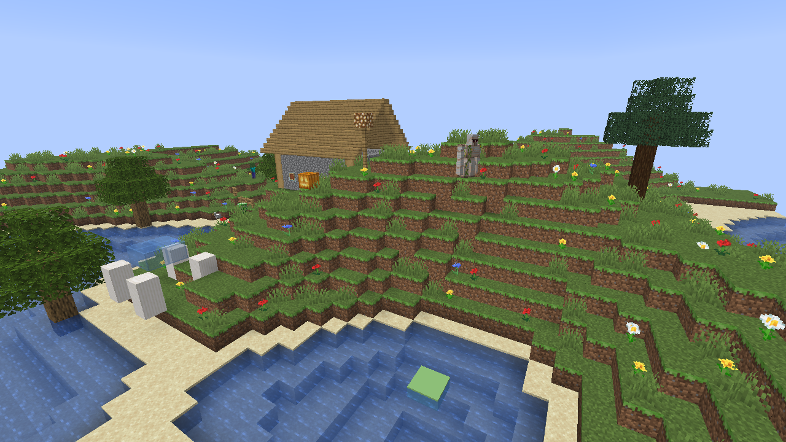
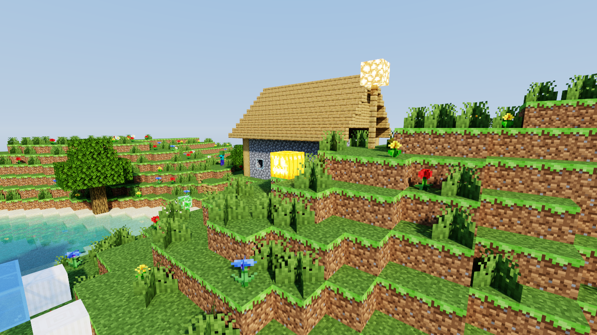
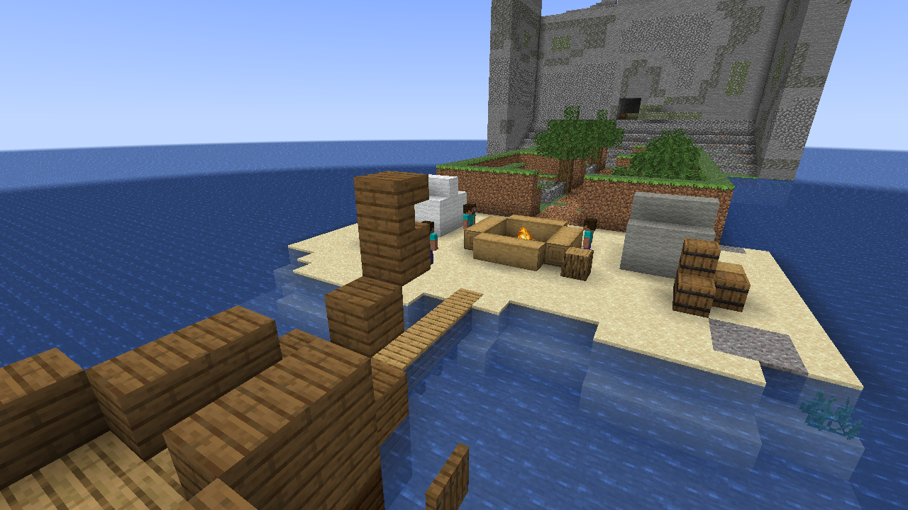
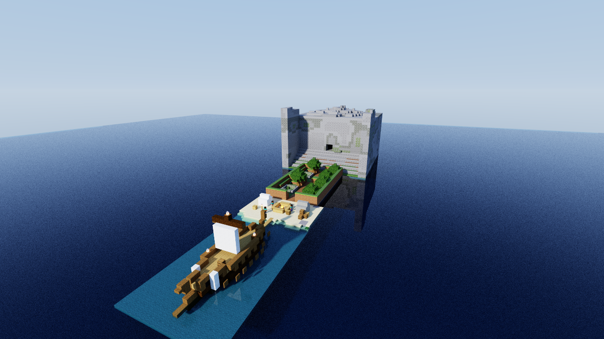
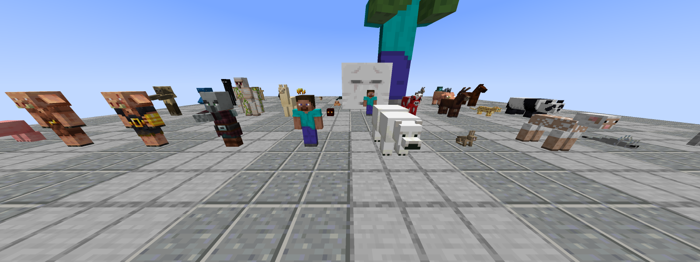
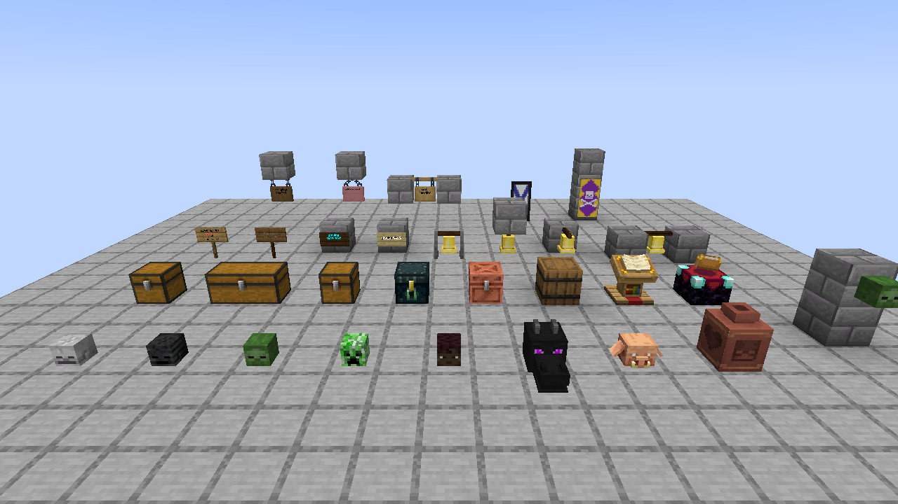
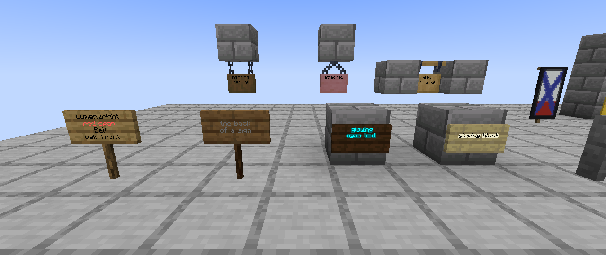

# Lumenwright

An offline, headless renderer for Minecraft Java Edition worlds. You give it a world save and
a camera, and it writes a PNG of the blocks and entities. It has two looks:

* **quick**: rasterized to look like the vanilla Java client, with no ray tracing.
* **hq**: a Chunky-style path tracer with sun and sky light, soft shadows, emissive blocks
  and refractive water.

Both modes run on several native backends: **CPU** (all cores), **Metal**, **Vulkan** and
**DX12** (through wgpu), and **CUDA** (the Rust path-tracing kernel compiled to PTX).

| quick (vanilla look) | hq (path traced) |
|---|---|
|  |  |
|  |  |

The images in `docs/renders/` are renders of original scenes drawn with Minecraft's textures,
and are shared under [Mojang's usage guidelines](https://www.minecraft.net/en-us/usage-guidelines)
for screenshots.

The requirements, design decisions and what is in or out of scope are in
[docs/SCOPE.md](docs/SCOPE.md).

## Quick start

```sh
cargo build --release

# Inspect a save
target/release/lumenwright info ~/path/to/saves/MyWorld --entities

# List the block entities (and sign text) in a box of x,z block coordinates
target/release/lumenwright info ~/path/to/saves/MyWorld --block-entities=-40,-40,40,40

# Vanilla-look render from the player's own viewpoint (level.dat)
target/release/lumenwright render -w ~/path/to/saves/MyWorld -o quick.png

# Chunky-look render from an explicit camera
target/release/lumenwright render -w ~/path/to/saves/MyWorld --mode hq --spp 256 \
    --camera 120,90,-40 --look-at 100,70,-10 --sun-altitude 35 --sun-azimuth 120 -o hq.png

# No world handy? Generate one:
target/release/lumenwright demo-world /tmp/showcase
target/release/lumenwright render -w /tmp/showcase --mode hq

# One of every block entity Lumenwright draws (the render below):
target/release/lumenwright demo-world --block-entities /tmp/gallery
target/release/lumenwright render -w /tmp/gallery \
    --camera 9.5,70.5,11.5 --look-at 9.5,65.4,-2 --fov 60
```

`lumenwright backends` lists the backends available on the current machine.

## Textures: the Chunky approach

Mojang's assets are not redistributable, so Lumenwright ships none. Like Chunky, it reads
textures, blockstates and block models straight out of the official client jar. The jar is
resolved in this order:

1. `--minecraft-jar <path>`
2. A launcher's copy for the world's version: the vanilla launcher's
   `versions/<v>/<v>.jar`, Prism Launcher's library, or Lumenwright's own cache
3. Chunky's `~/.chunky/resources/minecraft.jar`, if its version matches
4. A download from Mojang's version manifest (`piston-meta.mojang.com`), SHA-1 verified, into
   the cache (`~/Library/Caches/lumenwright` or `$XDG_CACHE_HOME/lumenwright`). `--offline`
   disables this; `lumenwright assets fetch <version|latest>` downloads ahead of time.

`--resource-pack` (zip or directory, repeatable) layers packs on top of the vanilla assets.

## Command line (render)

| flag | default | meaning |
|---|---|---|
| `-w, --world` | required | save directory (contains `level.dat`) |
| `--mode quick\|hq` | quick | vanilla raster or path tracing |
| `--backend auto\|cpu\|gpu\|metal\|vulkan\|dx12\|cuda` | auto | `auto` uses the GPU if one is available, otherwise the CPU |
| `--camera x,y,z` | player eye, else spawn | eye position |
| `--yaw`, `--pitch` | player's | Minecraft convention: yaw 0 = south, 90 = west; pitch > 0 looks down |
| `--look-at x,y,z` | | overrides yaw and pitch |
| `--fov` | 70 | vertical field of view in degrees |
| `--width`, `--height` | 1280×720 | output size |
| `--render-distance` | 8 | chunk radius loaded around the camera |
| `--dimension` | overworld | `overworld`, `nether`, `end` |
| `--time` | world time | ticks: 0 = sunrise, 6000 = noon |
| `--sun-altitude`, `--sun-azimuth` | from time | degrees, overrides `--time` for the sun |
| `--spp`, `--max-bounces` | 64, 4 | HQ sampling |
| `--exposure`, `--tonemap aces\|gamma\|filmic` | 1.0, aces | HQ post-processing |
| `--sun-intensity`, `--sky-intensity`, `--emitter-intensity` | 1.5, 1, 6 | HQ lighting |
| `--ssaa N` | 1 | quick-mode supersampling |
| `--brightness`, `--flat-lighting` | 0.5 | vanilla brightness slider, and smooth lighting off |
| `--hdr-output out.pfm` | | also write the linear HDR image (HQ) |
| `--no-entities`, `--players`, `--unknown-entities box\|skip` | | entity options |
| `--no-block-entities` | | leave out block entities drawn by Java code |

## Architecture

```
world/      Anvil regions, paletted chunk sections, light, biomes, entities, level.dat
assets/     client-jar resolution, blockstate variants/multipart, model baking, atlas, biome tints
scene/      material-resolved quads; quick mesh (culling, smooth light + AO);
            HQ brick grid (16³ bricks, u16 model instances, entity overlay cells); entity models
render/     Backend trait
  cpu/        tile-binned software rasterizer + lumenwright-kernel on rayon
  gpu/        wgpu: quick.wgsl (raster pipeline), pathtrace.wgsl (compute port of the kernel)
  cuda.rs     lumenwright-kernel compiled to PTX, launched via cudarc
lumenwright-kernel/  #![no_std] path tracer shared by CPU and CUDA (same source)
lumenwright-ptx/     CUDA entry point (builds for nvptx64-nvidia-cuda)
```

Both modes share one scene build. Quick mode turns visible quads into a triangle mesh, the
way the vanilla client does. HQ mode instances block models inside a sparse two-level voxel
grid: empty bricks are skipped and fully buried bricks are collapsed, so a ray needs one
traversal loop and no BVH. Entities go into sparse overlay cells of the same grid.

Backend parity is by construction. The CPU and CUDA backends run the same Rust kernel. The
WGSL kernel mirrors it line by line and uses the same RNG, so CPU and Metal draw the same
random numbers for each pixel and sample. Builds are deterministic: identical inputs give
bit-identical images.

Mob geometry lives in Java code in vanilla, not in assets, so it ships as data in
[`crates/lumenwright/assets/entity_models.json`](crates/lumenwright/assets/entity_models.json):
57 mobs in vanilla's own part, cube and box-UV terms, transcribed from 1.21.11. Adding a mob
needs no Rust changes. Block displays, paintings and mannequin or player skins are built in
code. Anything else is drawn as a box the size of its hitbox.



Block entities that vanilla draws in Java code use the same format, in
[`crates/lumenwright/assets/block_entity_models.json`](crates/lumenwright/assets/block_entity_models.json),
each model naming the 1.21.11 client class it is transcribed from. Their data comes from the
chunk's `block_entities`:

* signs and hanging signs, with front and back text in the vanilla bitmap font
  (`assets/minecraft/font`), dye colour, glowing text and its outline. A `translate` line
  resolves through the `en_us` language files of the jar and the resource packs;
* bells, the lectern's book and the enchanting table's book;
* chests: single, double, trapped, ender and copper;
* banners, with their pattern layers composited in their dye colours;
* decorated pots with their sherds;
* skulls and heads. A player head's skin is the profile's `texture` asset when a resource
  pack provides it, otherwise the default skin for the profile's UUID. Skins are never
  downloaded.




## Backends

| backend | quick | hq | tested here (Apple M2 Pro) |
|---|---|---|---|
| cpu | software rasterizer | Rust kernel on rayon | yes |
| metal | wgpu render pipeline | WGSL compute | yes, matches the CPU (see below) |
| vulkan / dx12 | same wgpu code | same WGSL | no, but these are the same code paths as Metal |
| cuda | falls back to the CPU rasterizer | Rust kernel as PTX | builds and the PTX compiles; not executed (no NVIDIA GPU) |

The CUDA backend needs the PTX built first:

```sh
scripts/build-ptx.sh                       # rustup target nvptx64-nvidia-cuda + llvm-bitcode-linker
cargo build --release --features cuda
lumenwright render ... --mode hq --backend cuda
```

`libcuda` is loaded at runtime, so CUDA builds work on machines without the CUDA toolkit.

## Testing

```sh
cargo test --workspace --release
```

* **Unit tests** cover region and NBT decoding, the LZ4 framing, palette unpacking, multipart
  rules, model baking orientation and UVs, the camera convention, sky and day cycle, the
  lightmap, the tonemapper, and entity box-UV and orientation.
* **Kernel tests** use hand-built buffers to check brick skipping, uniform bricks, entity
  overlay cells, cutout alpha, the sky, and pinned RNG values.
* **Integration tests** write fixture worlds and render them end to end. They check terrain
  colours seen from above, entity coverage, block entities in both modes, sign text, HQ
  sanity, CPU-vs-GPU parity in both modes (showcase and block-entity gallery), determinism,
  and the CLI. Tests that need the client jar or a GPU skip with a message when
  it is missing. `LUMENWRIGHT_MC_JAR` points the tests at a jar.

## Measured on an M2 Pro (10 CPU cores, 16 GPU cores)

| scene | mode / backend | time |
|---|---|---|
| island save, 33×33 chunks, 1920×1080 | quick / metal | 0.33 s end to end (24 ms raster, 497k triangles) |
| same | quick / cpu | 0.29 s end to end (65 ms raster) |
| same, 1280×720, 256 spp | hq / metal | 21 s |
| same, 1280×720, 16 spp | hq / cpu | 7.7 s (about 6× slower than Metal) |
| showcase, 1280×720, 256 spp | hq / metal | 11.8 s |

Parity on the same view: quick mode, CPU vs Metal, differs in 0.075% of pixels; HQ mode at
32 spp differs in 0.03%.

## Known limitations (v0.1)

See [docs/SCOPE.md §3](docs/SCOPE.md). The main gaps:
* Beds, shulker boxes and the conduit are not drawn. Chests are drawn closed and bells at
  rest; sign text is drawn without italic, underline or obfuscation.
* Items are not rendered: dropped items, item frame contents, item displays.
* Entity layers that need a second texture are missing (sheep wool, armour, glowing eyes).
* Smooth fluid surfaces, clouds, weather, biome blending and mipmaps are not implemented.
* There is no next-event estimation for emitters, so night scenes need many samples.
* The CUDA backend has not been run on NVIDIA hardware yet.

## License

Lumenwright is free software: you can redistribute it and/or modify it under the terms of the
GNU General Public License as published by the Free Software Foundation, either version 3 of
the License, or (at your option) any later version. See [LICENSE](LICENSE).

NOT AN OFFICIAL MINECRAFT PRODUCT. NOT APPROVED BY OR ASSOCIATED WITH MOJANG OR MICROSOFT.
Minecraft is a trademark of Mojang AB. Lumenwright ships no Minecraft assets: textures and models
are read at run time from the user's own copy of the game.
