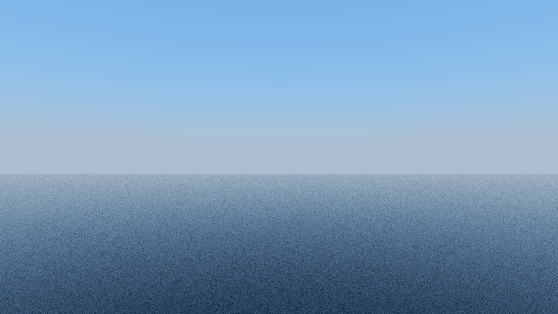
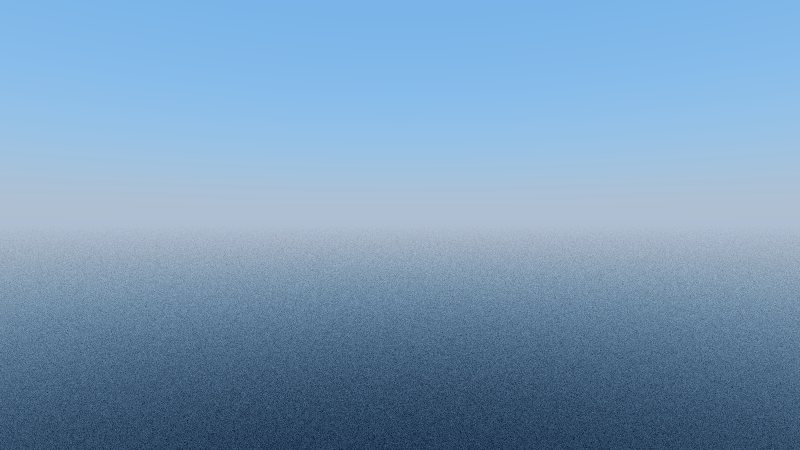

# The sea at the horizon in HQ mode

A level HQ frame out over an ocean showed the loaded sea ending in a hard edge some way
below the horizon, with a band of sky colour between the edge and the horizon. This note
records what the game draws there, what Chunky offers for it, and what HQ mode does. Each
statement is marked **[cited]** (the client, Chunky or a measurement's instrument says it),
**[measured]** or **[authored]** (Lumenwright's own rule). The client read is the 1.21.11
jar (`client.jar` sha1 `ba2df812c2d12e0219c489c4cd9a5e1f0760f5bd`) through Mojang's mappings
(`client.txt` sha1 `031a68bebf55d824f66d6573d8c752f0e1bf232a`); Chunky is read at revision
`156e2bba2526`.

## What the game draws there

* The client draws the chunks within its render distance and nothing beyond them. It fogs
  every terrain fragment towards the fog colour: the larger of the environmental fog over
  spherical distance and the render-distance fog over cylindrical distance, which reaches
  the fog colour at the render distance (`fog.glsl`, `total_fog_value`) [cited; quick mode
  ports it, `sky.rs` `fog_factor`].
* Below the horizon, where no terrain is, the frame keeps the clear colour, which is the fog
  colour (`AtmosphericFogEnvironment.getBaseColor`), and the sky disc fades to the same
  colour at the horizon [cited; quick mode, `sky.rs`].
* So in the game the sea fades into the fog colour at the render distance, and the fog
  colour meets the sky at the horizon: there is no edge and no band. The game does not draw
  a sea beyond what is loaded; its fog hides that there is none [cited, from the two
  above].

## Why HQ mode showed a band

HQ mode, like Chunky, draws no render-distance fog [cited: chunky-parity.md, *Fog*]. Its
grid holds the loaded chunks only; a camera ray that passes over the grid's last water and
goes on below the horizon meets nothing and reads the sky below the horizon (the client's
clear colour under the game's look, the horizon value under Chunky's Preetham sky). The
loaded sea's far edge is then a hard line, and the strip between it and the horizon is sky
[measured: the *before* frame below, mean row luma jumps by 12.45 across the edge].

## What Chunky offers: its water plane

Chunky's *water world* (`Scene.waterPlaneEnabled`, off by default) is an unbounded water
surface at a set height:

| Chunky | What it does | Lumenwright |
|---|---|---|
| `PreviewRayTracer.waterPlaneIntersection` | a ray meets the horizontal plane at `getEffectiveWaterPlaneHeight()` at a positive distance, from above as a water surface (normal up, into water), from below out of it | **Ported** [cited]: `integrator::water_plane` and its WGSL mirror; the meeting is the same Fresnel dielectric as a water block's surface (`water_interface`) |
| `waterPlaneChunkClip` (on by default): no plane where `isChunkLoaded` | the loaded world keeps its own water; the plane is only outside it | **Ported** [cited], at the grid's columns: a point of the plane inside the grid's x and z bounds is not met. **Lumenwright's own** [authored]: Chunky tests each chunk; a chunk missing inside the loaded rectangle gets no plane here |
| `Scene.isInWater`: below the plane outside the loaded chunks is water | a ray that leaves the loaded world under the plane is in water | **Ported** [cited]: a ray that leaves the grid below the plane and does not rise is in water (`under_water_plane`), so it adds no sky light, as a ray lost in water adds none |
| `waterPlaneHeight` (default `World.SEA_LEVEL`, 63), lowered by `Water.TOP_BLOCK_GAP` (0.125) while `waterPlaneOffsetEnabled` (the default) | the plane lies level with the top of Chunky's source blocks, which are 0.875 high | **Lumenwright's own** [authored]: the rule, not the constant. Lumenwright's source block is the client's, 8/9 high (`blockinfo::fluid_height`), so the plane lies at the sea level − 1 + 8/9 (`water_plane_height`); with Chunky's 0.125 it would sit 1/72 below the loaded sea and show a step |

**Off by default** [cited: Chunky's default; authored: the reason holds for Lumenwright]. A
world built over the void (the Treehouse Camp) has no sea, and a plane would put one under
it. `HqOptions::water_plane` (`--water-plane [SEA_LEVEL]`, 63 when the flag is given alone)
turns it on for a frame over an ocean.

**Not ported**: the game's render-distance fog in HQ mode. It would remove the band as the
game removes it, by fading the sea and everything at the render distance into the fog
colour, which Chunky does not do and which would grey every far HQ frame; the water plane
answers the frame the band spoils, a level shot over the sea, without changing any other.

## Before and after

The generated ocean (`lumenwright demo-world --ocean`: water to the edge of the 17 × 17
chunks a render distance of 8 loads, sea level 63), looked at level from the island's
tower, HQ mode at 64 spp, 800 × 450, under the default sky at the world's noon:

| | |
|---|---|
| without the water plane |  |
| `--water-plane` |  |

```sh
lumenwright demo-world --ocean ocean
lumenwright render -w ocean --camera 0.5,70,0.5 --yaw 0 --pitch 0 --fov 50 \
    --mode hq --spp 64 --width 800 --height 450 -o ocean-hq-before.png
lumenwright render -w ocean --camera 0.5,70,0.5 --yaw 0 --pitch 0 --fov 50 \
    --mode hq --spp 64 --width 800 --height 450 --water-plane -o ocean-hq-water-plane.png
```

The test `the_water_plane_carries_the_sea_to_the_horizon` draws the same view at 320 × 180
on the CPU and measures the largest change of mean row luma from one row to the next about
the grid's edge: 12.45 without the plane, 2.51 with it [measured]. The plane draws the
same on Metal as on the CPU (0.000% of pixels off by more than 16/255 at 16 spp,
`gpu_matches_cpu_in_hq_mode`) [measured].
